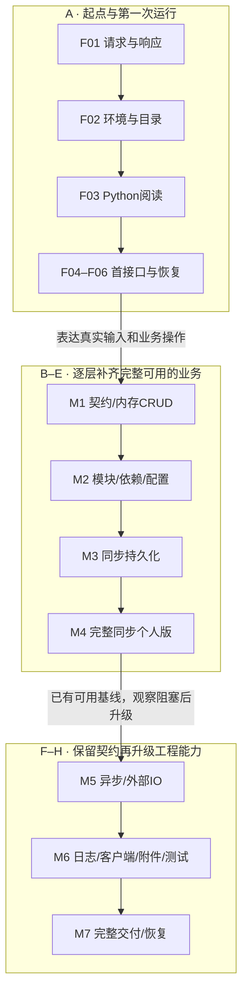

# FastAPI 基础教程：分区、章节与渐进 demo 设计

版本：FA-CURRICULUM-1.0。日期：2026-10-29。状态：**目录已定稿；W01/F01–F03 三章已编写，F04–F42 尚待逐批实施**。

本课程属于顶部 **FastAPI 教程**，入口仍为 `/learn`。它从后端初学者能理解的操作开始，逐步引入企业开发所需的工程习惯，结尾完成一个可运行、可测试、可部署的 FastAPI demo。这里的“企业级”指契约、组织、数据、权限、测试与交付质量，不是提前搭建复杂企业业务系统。

顶部 **FastAPI 项目实战** `/project` 是后续独立课程，不承担这次基础课的前置或结课 demo。LangChain/RAG 实战也不插入当前必学路线。旧教材和旧教学业务不恢复，本计划重新组织知识。

本文件负责课程分区、章节前置、demo 里程碑、图规格与源码发布规则。正式导航与搜索只展示已编写章节；当前 W01 三章使用新 lab 与固定源码，后续阶段仍为计划，不能视为已实现的 API 功能。

## 1. 读者起点与结课成果

### 起点

读者没有HTTP、Web框架、数据库或部署经验。只要求能操作电脑；变量、函数、字典、类型提示、模块、类等Python必需知识也有当前任务对应的解释。默认操作主线为 **Windows + PowerShell + PyCharm**，Python 3.12作为初始作者验证目标；macOS/Linux给有明确执行位置的命令支线。正式包版本在首批源码实现时核对稳定兼容并锁定，当前不将未运行的版本组合写成已验证。

学习顺序是前置能力，而不是“章节数量越多越专业”。首次执行命令前先解释终端和目录，首次使用类/装饰器/Depends/Session/await前先说明名称、来源、作用和数据走向。

### 最终 demo：TaskBoard API

采用一条小而完整的业务主线：**个人任务管理 API**。从一条公开读取接口开始，先无登录/无数据库，再得到个人任务列表和持久化，随后加入用户注册登录与任务归属。任务只包含逐步需要的字段，例如标题、说明、状态、截止时间和创建时间；附件在后段作为文件处理练习加入。

最终范围：

- 注册、登录、Bearer访问令牌、当前用户；输出不含密码或密码哈希。
- 任务创建/查询/更新/删除，按状态筛选、排序和分页；明确未提供字段与显式null的差异。
- 每个用户只能访问自己的任务；跨用户请求、无效输入、过期令牌和不存在对象有明确行为。
- 数据库持久化、事务/回滚、迁移、隔离测试；先完成SQLite同步版，再升级异步PostgreSQL版。
- 任务附件上传/读取/删除，路径、大小、权限和文件/数据库失败恢复有清楚边界。
- OpenAPI/交互文档、最小浏览器调用页、配置、日志、健康/就绪检查、超时与错误处理。
- pytest、CI、Docker/Compose、启动/停止、备份与恢复说明；干净环境能运行完整demo。

完整成果是**HTTP API + 一个极薄的操作客户端 + 文档与测试 + 交付配置**。浏览器操作页只用于体验注册/登录/任务操作，不扩成另一个前端开发课程；知识站与demo是不同程序，阅读教程不需要demo在线。独立最小示例只解释机制，不冒充demo的一部分。

企业SSO、多租户、RBAC组织系统、刷新令牌会话体系、分布式任务队列、微服务、DDD/CQRS、Kubernetes、向量库或付费模型调用不进入结课必需范围。需要时在独立实战课程说明，不让它们阻塞首个接口。

## 2. 官方依据与本课程的选择

课程组织采用 LangChain 官方文档的“入门 → 核心能力 → 进阶用途 → 交付”的分组阅读方式：**一个主题一页，页内连续小节，左侧分组课程导航，右侧本页目录，代码/命令/提示/图邻近解释**。不将42章堆进一页，不用按钮翻页替换整章正文。

| 依据 | 实际核对与课程用法 |
| --- | --- |
| [LangChain Quickstart](https://docs.langchain.com/oss/python/langchain/quickstart) | 独立主题页面、页内目录、前置/命令标签、连续步骤与完整代码展开 |
| [LangChain 官方文档仓库](https://github.com/langchain-ai/docs) | 固定提交 `ace09e0592332092f2b9c47496632793a4a485cc` 的README、导航配置、Quickstart；内容与平台职责分开 |
| [FastAPI Tutorial](https://fastapi.tiangolo.com/tutorial/) | 首接口、路径/查询、请求体/验证、响应、依赖、安全、数据库、测试和多文件组织等能力归属 |
| [First Steps](https://fastapi.tiangolo.com/tutorial/first-steps/) | 导入、实例、路由、启动、文档的分步解释；本课强化显式工作目录与停止/保存/重启 |
| [Dependencies](https://fastapi.tiangolo.com/tutorial/dependencies/) | 普通供值函数 → Depends注入，参数和调用者解释；默认缓存/资源清理后讲 |
| [SQL Databases](https://fastapi.tiangolo.com/tutorial/sql-databases/) | 官方当前示例采用SQLModel；**本课选择SQLAlchemy作为独立工具补课**，不伪称官方教程的ORM与本课完全相同 |

源码读取记录见[课程资料核对记录](../evidence/verification/fastapi-curriculum-sources.json)。FastAPI官网主分支会变化，正式教学源码发布时保存依赖版本和对应官方版本/链接，不把页面观测当作本demo已经运行。

页面视觉与共享组件仍以[LC-DOCS-2.0](./frontend-page-design.md)为准；讲解深度以[写作规范](./writing-standard.md)为准。下文只是新课程的结构，不复用已删除旧章。

## 3. 分区目录与页面层级

下面是可编辑的课程脉络图，表示知识/里程碑先后，不是demo运行流程。当前仅保存图源；正式教材配图需按章源码另行绘制和视觉验收。



### 正式页面结构（拟建）

| 层级 | 用途 | 拟用路径/导航 |
| --- | --- | --- |
| 课程入口 | 目标、起点、学习路线、demo成果、编写状态 | `/learn`，FastAPI教程 |
| 学习分区 | 左栏分组标题，解释该段解决的问题 | 下表A–H；不为每组制造空页面 |
| 章节 | 一个明确学习任务、前置、图、源码与练习 | `/learn/fastapi/<slug>`，一章一页 |
| 页内小节 | 现象/概念/编写/运行/观察/恢复/回讲 | 稳定hash，属于当前章 |
| 参考页 | 通用术语、版本/工具说明、源码索引 | 需要时另建受控TSX页，不承担隐藏前置 |

下面分组是**完整规划目录**。正式左栏/搜索只登记实际写作、运行和发布的章节；未完成项在课程入口以不可点击规划说明展示，不创建42个空路由骗作完成。

### A · 准备与首个运行闭环（F01–F06）

目的：读者能区分请求、文件、解释器、应用对象、路由登记、持续监听与客户端响应。F04第一次完成最小应用，F05首次完成真实HTTP闭环。

| ID · 章节 / slug | 必需前置 | 新概念必须解释 | 本章要做与观察 | 图形与源码位置（拟建） |
| --- | --- | --- | --- | --- |
| F01 · 看懂一次请求与响应 / `http-request-response` | 无 | 客户端/服务器、方法/路径/查询、请求头/正文、响应头/正文、状态码、JSON、主机/端口、进程 | 对照有来源标示的成功响应与错误路径示意；真实本地操作留F05 | HTTP消息往返图，字段与正文解释同步；`labs/f01-http/requests.http` |
| F02 · 找到解释器、终端与项目根 / `environment-and-project-root` | F01 | Python安装、终端命令/参数、CWD、venv、pip、包/版本、保存/扩展名、PyCharm解释器 | 在明确父目录建项目根/环境；运行检查脚本核对sys.executable、版本与导入，解释错目录/错环境 | 解释器/项目/依赖位置图，IDE与终端指向同一个环境；`labs/f02-environment/check_environment.py` |
| F03 · 读懂写接口需要的Python / `python-for-api` | F02 | 变量/赋值、函数定义与调用、缩进/return、字典/列表、import模块加载、类型提示、注释 | 运行普通函数、修改返回值；说明注解不会自动校验普通直接调用；首次装饰器先建立“登记”的使用直觉 | 模块加载与函数调用两条路径图；`labs/f03-python/functions.py`、`imports.py` |
| F04 · 创建第一个FastAPI应用 / `first-application` | F01–F03 | `FastAPI`来源/大小写、`FastAPI()`调用与实例对象、`app`变量、`@app.get`登记、路径操作函数、字典到JSON | 从空main.py分A导入/B创建对象/C完整路由；每块有原因注释与位置。普通Python加载可退出，不等于监听 | 加载/登记图与对象关系图，禁止提前画数据库/身份；`demo/main.py` 的A/AB/完整路由三个真实提交检查点 |
| F05 · 启动、请求、停止与重启 / `run-and-call` | F04 | Uvicorn/ASGI最少职责、模块:对象启动目标、host/port、两个终端、curl/浏览器/OpenAPI入口、停止信号 | 用显式环境从根启动，GET成功、未登记路径404、停机连接失败，再恢复；改message/路径各做一次对照 | 请求执行带匹配分支；停机在连接层结束，404不进函数；`demo/main.py`、`requests.http`，形成M0 |
| F06 · 保存、重载、断点与分层排错 / `debug-and-recover` | F05 | traceback、语法/导入/监听/HTTP层、reload子进程、断点/变量、IDE运行位置 | 先手工停止/保存/重启，再加reload观察；PyCharm断点看实际请求函数，分别恢复缩进/错目标/端口占用 | 按失败层组织的排错决策图；`labs/f06-debug/` + M0完整恢复源码 |

F01只阅读有来源标识的HTTP消息示意与可选已有网页观察，不要求安装客户端、运行Python或连接一个尚未写出的本地接口；正式本地HTTP运行到F05才执行。F02就在第一次命令处解释命令/参数/CWD，不能先要求“按前章启动”；F03实验只使用F02已创建的环境。

### B · 输入、输出与内存业务（F07–F13）

目的：用任务条目理解契约，先做到无数据库/无登录的内存CRUD。新语法和字段来源在首次出现时解释，不一开始贴最终大文件。

| ID · 章节 / slug | 必需前置 | 新概念必须解释 | 本章要做与观察 | 图形与源码位置（拟建） |
| --- | --- | --- | --- | --- |
| F07 · 路径与查询参数从哪里来 / `path-and-query` | F03、F05 | 路径占位、函数参数绑定、默认值/可选值、类型转换、查询参数、Query/Annotated的最少写法 | 先一个task_id，再加status/limit/offset；正常/无效输入对照，解释422位置；不直接写所有过滤条件 | URL字段→参数→函数图与无效参数分支；`demo/main.py` |
| F08 · 接收JSON请求体与Pydantic模型 / `request-body-models` | F07 | class、实例/字段、BaseModel、类型提示、模型与普通dict区别、Pydantic工具归属 | 先读取一字段，再定义TaskCreate；解释每个模型字段谁提供；请求体不混入服务器id | JSON→模型字段→函数图；`demo/main.py`，类/字段最小补课在正文之前 |
| F09 · 验证规则与错误定位 / `validation` | F08 | Field、长度/范围、必填/默认、null、枚举/状态、校验错误loc | 逐个加入标题长度/状态限制；坏字段/缺字段/null对照并修复；不以“框架自动做了”跳过因果 | 字段约束验证分支图与错误定位示意；`demo/main.py` |
| F10 · 响应模型、状态码与OpenAPI契约 / `responses-and-contracts` | F09 | response_model、输入/输出模型分离、过滤字段、uuid、datetime/UTC/序列化、200/201、204语义、Location最少含义 | 先普通dict再TaskRead；逐项解释服务器id/时间来源；/docs核对契约，实际删除204在F11操作 | 内部对象→输出模型→客户端过滤图；`demo/main.py`、`requests.http` |
| F11 · 完成内存任务CRUD / `in-memory-crud` | F10 | 内存存储/生命周期、GET/POST/PATCH/DELETE、Response/204无正文、部分更新、未提交字段与显式null | 按创建→列表/详情→更新→删除逐个加接口，删除后详情404与空正文204分别观察；重启丢数据引出数据库 | CRUD状态与数据去向图，标PATCH字段分支/重启边界；`demo/main.py` |
| F12 · 错误处理与一致的失败行为 / `errors-and-http-exceptions` | F11 | HTTPException、业务错误/验证错误、404/409、异常与返回、错误契约 | 不存在任务、重复/非法状态转换等具体冲突；先局部HTTPException再必要统一处理；不泄露内部trace | 请求→业务判断→成功/404/409/422结果图；`demo/main.py` |
| F13 · 给内存API写第一组测试 / `first-api-tests` | F12 | pytest/test/assert、TestClient、测试函数、fixture的最小含义、可重复状态 | 每接口一个成功/一个失败；请求不依赖正在监听的终端，和真实HTTP检查分别记录；改坏代码看到测试失败 | 真实HTTP与TestClient测试两条入口图；`demo/tests/test_tasks.py`，形成M1 |

### C · 组织代码与复用能力（F14–F18）

目的：先展示单文件实际问题，再保留API行为进行小步组织改造；普通函数与Depends分开，数据库仍未引入。

| ID · 章节 / slug | 必需前置 | 新概念必须解释 | 本章要做与观察 | 图形与源码位置（拟建） |
| --- | --- | --- | --- | --- |
| F14 · 从单文件走到包与模块 / `packages-and-entrypoint` | F13 | 模块/包、__init__.py、导入方向、完整路径、入口迁移、共享内存 | 先建包/空文件，迁main并同步启动目标；数据只有一个来源；每个原子组完成复测CRUD | 目录包含图 + 导入依赖图，区分关系；`demo/app/main.py`、`schemas.py`、`store.py` |
| F15 · 用APIRouter拆分接口 / `routers` | F14 | APIRouter、include_router、prefix/tags、路由装配、保留公开路径 | 先空router再迁一个GET，随后CRUD；不生成全部空分层；启动入口保持能运行 | 应用→router→操作的装配图；`demo/app/api/tasks.py`、`app/main.py` |
| F16 · 普通函数到Depends / `dependencies` | F15 | 参数重复/普通调用、Depends供值、谁调用、请求参数来源、子依赖、请求内缓存 | 独立分页函数→两个路由重复→一次注入→复用→同请求/下一请求计数；首例不含ORM/认证 | 双版本调用图 + 局部DAG/缓存对照图；`labs/f16-dependencies/`、`demo/app/dependencies.py` |
| F17 · yield与请求资源清理 / `yield-and-resources` | F16 | 生成器暂停/继续、try/finally、上下文管理、打开/使用/关闭、异常传播 | 用可观察的独立资源成功/失败实验理解清理，再说明后续Session承接；不把关闭=提交 | 资源生命周期时序图，按锁定框架版本实測顺序；`labs/f17-resources/` |
| F18 · 配置、环境变量与依赖锁 / `settings-and-locks` | F17 | 常量→环境→Settings、pydantic-settings归属、默认/覆盖、.env、pyproject/uv、秘密与配置 | 一个配置值先常量再Settings，解释谁读取/何时缓存；pip环境已理解后才用uv，核对同一解释器/锁 | 配置来源与优先级图；`demo/app/config.py`、`pyproject.toml`、锁/环境示例，形成M2 |

### D · 数据库与同步可交付版本（F19–F24）

目的：先解释关系数据库，再引入ORM/Session。先做同步SQLite版并通过数据/事务/迁移测试，才继续身份或异步升级。

| ID · 章节 / slug | 必需前置 | 新概念必须解释 | 本章要做与观察 | 图形与源码位置（拟建） |
| --- | --- | --- | --- | --- |
| F19 · 表、SQL与持久化 / `sql-and-persistence` | F11、F18 | 行/列、主键、索引/唯一约束、SQL查询、关系库与文件、连接 | 先用小SQL读写任务，重启后仍在；和内存版并排说明代价/差别 | 内存与SQLite读写对照图、Task字段关系；`labs/f19-sql/` |
| F20 · SQLAlchemy映射与数据库连接 / `sqlalchemy-mapping` | F19 | ORM类/表映射、Engine/连接、模型与Pydantic schema区别、SQLAlchemy独立工具 | 逐字段映射任务表，先最小查询再装配demo；不混用SQLModel教程术语或直接贴异步ORM | Python对象↔表字段映射与schema输出对照；`demo/app/db.py`、`models.py` |
| F21 · 每次请求的Session与查询 / `sessions-and-queries` | F17、F20 | Session/连接不是一物、工厂、依赖yield、select/result、关闭 | 先独立查询再迁demo读取接口，说明资源取得与关闭；本章不在未讲commit时暗中完成ORM写入 | 请求/依赖/Session/数据库时序；`labs/f21-sessions/`、`demo/app/dependencies.py` |
| F22 · 事务、提交与失败回滚 / `transactions` | F21 | unit of work最少含义、commit/flush/refresh、rollback、边界/原子性 | 引入写入/提交后逐个迁CRUD；用同表两条任务变更制造失败验证同次回滚，不增加审计/团队新业务；读路径不乱提交，关闭不代替提交 | 事务成功/异常回滚图，数据库效果对照；`demo/app/services/tasks.py`（此时才因业务复用引入service） |
| F23 · Alembic迁移与已有数据 / `migrations` | F22 | schema变化/版本链、revision/upgrade/downgrade、autogenerate限制 | 在已有任务数据上加字段/索引，升级后保留数据；失败在可丢弃副本恢复，不以删库重建升级 | 迁移链/前后schema图；`demo/migrations/` |
| F24 · 隔离测试数据库并验收持久化 / `database-testing` | F13、F23 | 独立测试库、fixture建立/清理、依赖替换、状态污染/重复运行 | 测CRUD/422/404/409、重启保留、回滚/迁移，确认测试不动自己的学习数据库 | 应用/测试库隔离与清理时序；`demo/tests/conftest.py`、`test_persistence.py`，形成M3 |

### E · 身份、归属与完整同步 demo（F25–F28）

目的：先证明“是谁”，再证明“可以操作什么”。完成一个已有业务可使用、可测试的同步版本，再进入异步与生产升级。

| ID · 章节 / slug | 必需前置 | 新概念必须解释 | 本章要做与观察 | 图形与源码位置（拟建） |
| --- | --- | --- | --- | --- |
| F25 · 用户模型与密码哈希 / `users-and-passwords` | F08、F23、F24 | 用户表/唯一标识、哈希/salt/验证、密码与hash、响应不泄露、密码库 | 先独立hash/verify实验再注册；冲突409；UserRead排除秘密，迁移先建新表 | 密码输入→哈希→验证/安全输出图；`demo/app/security.py`、`api/users.py`、迁移 |
| F26 · 登录与Bearer令牌 / `login-and-tokens` | F25 | JSON登录模型、签名JWT/claims/exp、Bearer header、HTTPBearer/认证依赖、401、密钥/过期 | 主线用JSON登录+HTTPBearer，沿用已讲请求体，不隐藏未来Form/OAuth2前提；验证签名/过期后取用户，无令牌/坏/过期分别观察 | 登录时序 + 后续请求认证流程；`demo/app/api/auth.py`、`security.py`、`dependencies.py` |
| F27 · 任务归属与对象访问边界 / `ownership` | F26 | owner_id/外键、认证vs授权、列表过滤/单对象检查、对象存在性策略、已有数据策略 | 创建时由当前用户赋owner；两用户交叉访问；既有匿名数据用明确迁移/认领或拒绝策略，不能静默丢弃 | 用户→任务归属图 + 列表/详情授权分支；`demo/app/models.py`、`api/tasks.py`、迁移 |
| F28 · 验收完整同步版本 / `synchronous-demo-checkpoint` | F27 | 业务闭环与安全回归、使用说明、启动与恢复 | 从干净环境注册/登录/CRUD/筛选分页，重启/迁移保留，跨用户隔离，测试重跑；列明基础令牌撤销边界 | 同步版完整请求架构 + 两用户操作泳道；`demo/`全集合及`tests/test_auth.py`，形成M4 |

### F · 并发、异步与外部服务（F29–F33）

目的：已有完整同步版后，解释实际阻塞/吞吐问题再升级；不能只给每个函数加async或只换一个数据库URL。

| ID · 章节 / slug | 必需前置 | 新概念必须解释 | 本章要做与观察 | 图形与源码位置（拟建） |
| --- | --- | --- | --- | --- |
| F29 · def、async def与阻塞 / `concurrency-and-async` | F03、F28 | 协程/事件循环/await、阻塞IO/CPU、线程池、并发不等于并行 | 同步等待→错误阻塞async→可等待IO对照；先小实验后确定demo要改哪些调用 | 并发时间线，等待/执行分区；`labs/f29-concurrency/` |
| F30 · lifespan与应用级资源 / `lifespan` | F17、F29 | asynccontextmanager、应用启动/运行/关闭、共享资源/请求资源、app.state | 一个应用级资源创建一次，用后关闭；启动失败与关闭可观察，区别Session每请求生命周期 | 应用/请求资源双泳道时间线；`labs/f30-lifespan/`、`demo/app/main.py` |
| F31 · 升级AsyncSession与PostgreSQL / `async-database-upgrade` | F23、F24、F29、F30 | 数据库服务、驱动、AsyncEngine/AsyncSession、await、工厂/池、PostgreSQL差异、数据迁移 | 先独立PostgreSQL连接再逐项换同步ORM；不同根/配置保留同步M4；数据库DDL迁移与SQLite数据搬迁分别验证 | 同步/异步调用对照 + Session生命周期；`demo/app/db.py`、models/dependencies、迁移与数据迁移操作 |
| F32 · HTTPX调用、超时与测试替身 / `outbound-http` | F30、F31 | AsyncClient、请求级超时、外部HTTP失败、连接复用、MockTransport、幂等与重试 | 先真实本地可控服务，再可复测替身；为任务摘要提供可选外部适配，默认本地mock可用，不需要收费模型；不无限重试写请求 | 浏览器→API→外部适配成功/超时/失败时序；`demo/app/integrations/summary.py`、`labs/f32-httpx/` |
| F33 · 验证异步升级没有破坏原契约 / `async-regression` | F28、F32 | 异步测试runner/fixture、lifespan启动、资源关闭、业务回归与并发边界 | 复用M4请求契约，补PostgreSQL集成测试、外部超时/取消/清理；async测试与TestClient不同入口说明 | 测试入口/资源开启关闭时序；`demo/tests/test_async_api.py`、`test_summary.py`，形成M5 |

### G · 可观测、浏览器与文件能力（F34–F38）

目的：用真实请求与失败建立工程闭环；有意义的高级特性以独立实验说明边界，不变成完整demo的隐性基础设施。

| ID · 章节 / slug | 必需前置 | 新概念必须解释 | 本章要做与观察 | 图形与源码位置（拟建） |
| --- | --- | --- | --- | --- |
| F34 · 中间件、日志与请求定位 / `middleware-and-logging` | F33 | 请求/响应包围、request_id、结构化日志、耗时/异常、敏感字段脱敏 | 一个计时/请求id中间件开始，追踪成功与异常；不记录密码/令牌，避免把middleware当业务权限 | 请求往返包围与异常传播图；`demo/app/middleware.py`、日志配置 |
| F35 · CORS与最小浏览器客户端 / `browser-client-and-cors` | F26、F34 | origin、预检/allowlist、浏览器与curl不同、fetch/Promise最少补课、令牌header | 分开端口运行极薄客户端，登录/查看/操作任务；CORS拒绝与正常对照；不是完整前端框架教学 | 浏览器预检/真实请求双阶段时序；`demo/client/index.html`、`app/main.py` |
| F36 · 上传附件与文件边界 / `task-attachments` | F27、F33 | multipart、UploadFile/流、路径/UUID、大小限制、文件与DB非同一事务 | 挂到当前用户任务，上传/读/删；拒绝不合大小/类型/越权，写文件或写DB失败给清理/恢复；不信任客户端文件名 | 上传/权限/存储/元数据成功与补偿分支；`demo/app/api/attachments.py`、`storage.py` |
| F37 · BackgroundTasks：先认识能力边界 / `background-tasks` | F30、F34 | 响应后执行、进程内任务/丢失风险、失败记录、同步vs任务队列 | **选读独立实验**：非关键后处理，停止进程观察丢失风险；不承诺可靠任务或把它用作结课持久导入功能 | 响应与后台执行时间线，进程关闭边界；`labs/f37-background-tasks/`；结课demo不依赖本实验 |
| F38 · 测试夹具、回归集与CI / `test-suite-and-ci` | F13、F24、F33、F35、F36 | app工厂/隔离配置、测试分层、测试夹具复用、lint/type边界、CI环境 | 将原业务/资源/上传/客户端边界检查组织为可重复套件；本地测试与真实服务检查并存；演练一个失败 | 单元/集成/HTTP层与隔离资源图；`demo/tests/`、工作流与运行脚本，形成M6 |

### H · 生产习惯、交付与完整 demo（F39–F42）

目的：把已经理解的应用交付成可复现的程序，说明运行/资源/部署边界，而不是承诺适用于所有企业的架构或SLA。

| ID · 章节 / slug | 必需前置 | 新概念必须解释 | 本章要做与观察 | 图形与源码位置（拟建） |
| --- | --- | --- | --- | --- |
| F39 · 生产配置、健康与就绪 / `production-runtime` | F18、F30、F38 | dev/prod、reload退出、进程/worker、liveness/readiness、数据库未就绪、秘密/环境、超时 | 生产方式启动；数据库断开、端口/配置错分别观察；健康不因模型服务收费/不可用就伪造成功 | 启动/就绪决策 + 应用/数据库失败边界；`demo/app/health.py`、配置/部署环境示例 |
| F40 · Docker与Compose运行同一个应用 / `docker-delivery` | F31、F39 | 镜像/容器、构建上下文、容器端口/网络/卷、数据库服务/健康、非root | 先应用镜像再Compose数据库，解释每条必需配置；HTTP闭环/停止/重建/数据卷持续；不恢复github.io | 用户→容器端口→API→PostgreSQL/文件卷拓扑；`demo/Dockerfile`、`compose.yaml` |
| F41 · 备份、恢复与升级演练 / `backup-and-recovery` | F23、F36、F40 | 数据与文件备份一致性、迁移前备份、恢复验证、版本回退限制 | 可丢弃环境备份DB/附件后恢复；旧数据验证、升级失败恢复，应用回退与数据回退分别说明 | 升级/备份/恢复状态图，标成功判据；`demo/ops/`、README/恢复操作说明 |
| F42 · 从空环境交付完整demo / `complete-demo` | F28、F38、F41 | 完整文件集合、安装/启动/体验/测试/清理、复现验收、能力边界 | 作者照文档从零安装，注册/登录/CRUD/筛选分页/附件、数据重启、权限/错误/回滚、测试/容器恢复全部通过；留下版本/源码索引 | 最终部署/请求架构图 + 用户操作主线，拆两图不塞一屏；`demo/`全集合，形成M7 |

F37是选读，不作为F38–F42必需前置。除它外的41章构成默认主线；读者已经掌握某些起点技能时可通过前置自检跳读，不设置强制考试锁。

F07先用可解释的字段回显/固定小数据讲绑定，状态枚举在F09才引入；F10新增的uuid/datetime先解释再使用。F20只在全新空数据库里演示初始建表；已有数据结构升级从F23统一走迁移。F21先用独立Session/查询实验，不发布“内存写入+数据库读取”这种不一致demo为可运行检查点；F22完整CRUD写入改造完成后才切换全库，M3验收整个集合。

F27的匿名数据处理采取明确渐进步骤：先可空owner字段/已有数据检查 → 指定已注册的学习用户做受控一次性归属映射 → 数量/内容复测 → 再收紧非空与归属查询。具体迁移在实现批次对可丢弃副本验证，不静默清库、不在启动时自动给未知用户认领。基本JWT暂不支持即时注销/刷新轮换，M4/M7写清过期前仍有效；这些能力不是本课隐性承诺。

匿名数据归属变更先备份，再由作者明确指定且核验已注册用户，确认未归属数量归零后收紧约束；不提供任意登录用户抢认旧数据的接口。对象不属于当前用户时统一按404处理，列表从查询阶段按owner过滤。F26的HTTPBearer/依赖在锁定版本中统一缺失/无效凭据为401并给WWW-Authenticate，/docs手动输入取得的Bearer令牌也要真实跟做；不能依赖不同框架版本的默认403/401行为。

F31在尚未学Docker之前，主线使用PostgreSQL官方安装包/系统服务与psql最小操作：当章解释服务、连接参数、创建学习库/用户、驱动与权限，给Windows主线及macOS/Linux支线。不要提前用F40未讲的Compose命令。先同步SQLite→同步PostgreSQL验证差异和数据搬迁，再同步调用→异步驱动/Session验证行为；最终异步PostgreSQL完成才发布M5。DDL迁移与实际旧数据复制/字段映射各有独立检查和恢复，不能只改URL或直接清库。F32外部摘要是可选能力，关闭外部适配仍能完成M7所有核心业务。

## 4. Demo里程碑与完整版本集合

| 里程碑 | 达成章 | 此时可用的完整成果 | 引入下一层的具体理由 |
| --- | --- | --- | --- |
| M0 · 首接口 | F05 | 一个main.py、最少依赖、启动/请求/404/停机恢复 | 多输入与业务操作尚未表达 |
| M1 · 内存CRUD | F13 | 输入/输出/校验/CRUD/错误、第一套测试 | 单文件增大，重启丢数据 |
| M2 · 模块化内存版 | F18 | 包/routers/普通依赖/配置，原契约通过 | 内存无法长期保存或使用数据库约束 |
| M3 · 同步持久化版 | F24 | SQLite、ORM、请求Session、事务/迁移、隔离测试 | 无身份，任何调用者可操作任务 |
| M4 · 完整同步个人版 | F28 | 注册/登录、owner边界、业务与安全测试，重启可恢复 | 并发等待与外部IO的具体问题，需要升级而非补基本业务 |
| M5 · 异步/PostgreSQL版 | F33 | 对外业务契约保留、异步资源/数据库、可选外部摘要适配 | 需要定位请求、浏览器和文件能力、扩大回归 |
| M6 · 工程能力版 | F38 | 日志/请求定位、最小客户端、附件、完整回归/CI | 开发启动不能代替可复现交付 |
| M7 · 完整交付demo | F42 | 生产配置/健康就绪、Docker、DB与附件持久化、备份恢复、完整源码/手册 | 结课；后续复杂企业/AI业务在独立实战课程 |

每个M都是**当时完整可运行集合**，无需后章未来文件即可启动；依赖锁、启动根/目标、配置、迁移与验证步骤一并固定。章内新增动作小步完成；跨文件修改有不可运行编辑组时明确标识，组完成才记录成功。M4不能依赖F31数据库服务才工作，M7也不能把F37进程内后台实验变成可靠任务依赖。

最终并存两个明确可用检查点：同步SQLite的M4作为回顾/低门槛版本，异步PostgreSQL的M7作为默认完整交付；它们来自各自固定提交，不是两份永远手工同步维护的代码。后续默认演进M7，M4用固定链接保留学习回溯。

### M7完成判据

| 类别 | 必需操作与证据 |
| --- | --- |
| 起动与文档 | 干净环境按说明安装/锁版本/迁移/启动；/docs、health/readiness与配置行为真实可见 |
| 业务 | 注册登录、任务CRUD、状态筛选/排序分页、附件上传读删、最小浏览器端可操作 |
| 数据与身份 | 重启保存、两用户交叉访问拒绝；响应没有密码/hash，错误不泄露秘密 |
| 错误与恢复 | 422/401/404/409、外部超时、DB/文件失败、事务回滚、依赖未就绪和配置失败能够解释/修复/复测 |
| 迁移与交付 | 已有数据迁移、独立测试库不污染应用、测试可重跑、镜像/Compose运行、DB与附件备份恢复 |
| 阅读与源码 | 每章来源链接存在、源与图/片段/hash一致、桌面/手机/键盘可读、未执行项明确待验证 |

作者代码测试、作者从空环境跟做、真实初学者反馈和部署分别记录。M7只有在本表对应操作实际通过后才称“完整可交付demo”；计划中的功能、源码目录存在或测试数量不等于已完成。

## 5. 每章的讲解与小节契约

每章采用一个独立TSX页面，页内小节连续，不把整个分区或全课程合并为一页。

1. **这章解决什么**：一个具体输入/操作与目标结果；说明该章位于哪一层。
2. **开始前**：已经知道的概念、此章必需补课、当前完整版本、项目根/环境/依赖/文件位置。
3. **先理解**：新名称从哪里来、字面含义、运行时作用、与已有概念的区别；一次一个主要机制。
4. **预测与小块编写**：为何改、在哪插入/替换、原因注释、完整语义代码、保留的上下文。
5. **看图与观察**：图紧邻解释，实际命令/请求、稳定字段与失败结果单列；预览标示意。
6. **恢复与回讲**：错误在哪一层、检查哪个文件/值、完整恢复来源、复测和一个最小改动。
7. **本章源码与下一主题**：固定版本完整源、关键语句的仓库链接、下一章已发布才提供链接。

### 首次新概念不跳过的作者清单

F04中不能把 `app = FastAPI()` 当作读者已经知道的普通代码：逐项解释`FastAPI`来自包、大写拼写、括号创建对象、`=`赋值、app是对象引用、对象保存路由信息、Uvicorn负责监听。不是声称“这行启动服务器”，也不是在首章先讲完整类/ASGI内部协议。

`@app.get`解释登记条件与函数绑定，`def`解释定义、缩进/冒号/调用与return，字典变JSON与print区分。首例采用同步`def`，async/await留F29，避免五条核心语句里又藏协程前置。基本类型提示F03，`Annotated`只在实际Query/Depends写法需要时就地解释，不一次给多种写法让初学者猜主线。

F08先讲最少class/字段/实例再BaseModel；F14先讲包/导入方向再router；F16先普通函数再Depends；F17先生成器/try/finally再Session；F19先SQL再ORM；F25先hash/verify再身份；F29先阻塞对照再async。首次使用时给解释，不只追加术语链接。

为每章维护“requiresConcepts → 首次解释位置 → introducesConcepts”作者台账；本轮按章前置规划，正文阶段填真实位置。找不到前置解释就补当前必需最小知识或后移机制，不把术语名单当已讲过。

## 6. 流程图规格：清楚且有设计质量

图先确定它要回答的因果问题，再选流程/时序/关系/资源时间线/目录图。上面的每章矩阵均指定了图的任务；即使章节没有改变demo，也有与当前操作有关的图，而不是所有页面复制同一条“请求→函数→响应”。

### 必需语义

- 区分加载/登记与真实请求；客户端、服务器、应用、数据库/文件/外部服务只在本章已解释后出现。
- 边表示调用、消息、依赖、包含或数据效果时有正确方向和必要标签；目录父子关系不用import箭头代替。
- 选择当前机制有意义的成功/失败分支，条件/结果明确；404进入应用但不执行函数，连接失败没有HTTP响应，422、401/归属拒绝分别位于实际层。
- 资源图标清创建、取得、使用、提交/回滚与关闭；时间顺序按教学依赖锁/实际运行证据，不由作者想象。
- 每图有标题、输入/输出与关联文件/片段；混合关系/颜色需要解释时才加legend，预设结果为示意，不冒充trace或真接口执行。

### 美感与可读性

沿用LangChain模板的字体/双主题和颜色角色。用**对齐的泳道/边界、层次分组、合理留白、统一节点宽高/间距、清晰条件与回边**表现机制；正常/异常有克制的语义强调，不加点阵、闪动、自由拖拽手柄或装饰粒子。

局部图默认3–7个核心节点，以机制完整性决定数量，不能为凑数量增删节点；必要8–9节点须记录不宜拆分的原因并复核正文/手机可读性，这是共享页面预算的明确例外。再大机制优先拆成“加载/请求”“成功/失败”“目录/调用”两图，或由读者主动开全图。课程路径总览可更大，明确它是索引，不在每章重复。legend只在混合关系/颜色需要解释时出现，简单图直接标边即可。

正文约617–664px与320/390px窄屏分别构图：手机优先纵向/局部视图，节点文字至少14px，长标签分行，箭头不穿文字，不能整张图缩字。选择节点在本图附近展示解释/源码，键盘等价列表和失败/无JS说明同数据。滚轮仍滚正文，局部图选择不修改整章checkpoint。

作者设计前先画草图与图说明，逐边对照当前源码/输入；运行后用一个改动对照成功/失败，最后做桌面/手机/暗色/键盘视觉复核。**图来源正确、因果正确和版式美观是三个验收项**；现有简单组件示例只验证框架，不作为正式教材配图质量。

## 7. 源码目录与GitHub跳转契约

### 源码目录规划与实际进度

```text
courses/fastapi/
  README.md                    源码用法与课程目录
  labs/f01-http/...            独立的机制实验，按需创建
  labs/f02-environment/...
  labs/f03-python/...
  labs/<chapter-id>-<topic>/...
  demo/                        同一个渐进任务管理API
    main.py                    最初单文件，仅当阶段需要存在
    app/                       拆分后才创建，不与旧main长期重复
    tests/                     F13起渐进维护
    migrations/                F23开始
    client/                    F35开始
    ops/                       交付/恢复时创建
  source-manifest.json          章节/步骤/版本/sourceRef索引
web/src/content/fastapi/
  chapters/<slug>.tsx           新的独立章节解释与组件
  index.ts                     已发布章节登记，不批量空页面
```

矩阵中的`demo/...`与`labs/...`均以`courses/fastapi/`为根。当前已建立W01 lab与真实固定manifest，尚无demo服务。lab运行位置与demo根分别显示，不以lab副本当demo启动，也不登记空SHA。

### 版本与来源

每个可运行章/步骤有完整Git检查点：chapterId、stepId、checkpointId、前一恢复点、40位commit SHA、完整文件集合、sourceRoot、文件hash、Python/依赖锁、CWD、入口、命令/请求与观测。初期A、A+B、完整路由是三个真实状态，不裁最终文件删行伪造。当前demo目录在Git中逐步演进，旧检查点通过固定提交回溯，不同时维护所有未来版本的副本。

源码先写/运行并提交推送，页面随后提交B引用已发布来源。**每个步骤/恢复版本固定各自SHA**：F04-A、F04-AB、F04-final分别是不同完整源码提交，不要求整章只用一个SHA。页面B的manifest记录这些已存在提交的sourceRef；源码提交不写自己的未知SHA，避免自引用。片段、完整文件、恢复来源和链接从各自sourceRef提取，不以final代码回填前面步骤。

新机器取源默认流程：读取页面提交中的manifest → 校验sourceRoot/path和40位SHA白名单 → 检查本地Git对象 → 缺失时从已配置origin获取对应不可变检查点ref并比对其SHA → 按指定提交提取白名单完整文件 → 核对逐文件SHA-256/片段行号 → 写入按SHA隔离的构建缓存 → TSX读取生成数据。CI可使用完整历史；另必须用无缓存浅克隆验证缺对象流程。若远端拒绝按SHA获取，使用该发布检查点ref取得后再严格验证SHA，不能退回main或工作树。取源/哈希/行号失败阻止课程构建，不输出伪成功代码或死链接；核心站点发布包带已生成的源码展示资源，读者阅读时无需Git/外网。

检查点ref可以是稳定标签或专用ref，教学链接最终仍固定SHA；ref若被移动且不匹配manifest则拒绝取源。W02必须实测一次“远端源码提交 → 页面固定引用 → 无缓存浅克隆取源 → 物化完整恢复集合 → 真实启动/请求”的闭环。实验运行根与构建源码缓存不同，读者不用进入构建缓存运行demo。

### 学习页中的入口

- 页头/本章末提供“本章完整源码”“本章起点/恢复版本”“本次改动”的明确按钮或链接；没有对应来源就不显示。
- 代码组附近提供“在GitHub查看此文件”，关键语句可链接到固定行位置，源路径、版本与页面当前代码一致。
- 前后检查点的比较可使用固定提交compare链接；不拿main当前文件解释旧步骤。

| 链接类型 | 生成格式 | 发布检查 |
| --- | --- | --- |
| 完整目录 | `https://github.com/ban-code-art/ai-engineering-roadmap/tree/{commit}/{sourceRoot}` | sourceRoot可为课程demo或对应lab，远端commit/集合属于本章 |
| 具体文件 | `.../blob/{commit}/{sourceRoot}/{path}` | 来源按本章demo/lab登记；文件存在、内容SHA-256匹配 |
| 关键行 | 具体文件固定URL + `#L{start}-L{end}` | 行号从该提交真实片段提取、不越界、不带未来代码 |
| 本次改动 | `.../compare/{before}...{after}` | 两端真实提交、变化说明属于当前动作 |

花括号格式只说明生成方式，不可替换成假SHA。W01页面已引用先行发布的源码提交`739a0646e7a07a05f29e8316773f0fc5adb4d23b`；未来批次仍须先发布源，再核对tree/blob、hash、行号与完整恢复。源码未发布的章节标“待编写”，不给404按钮。

F38中CI位于真正的仓库根`.github/workflows/`，按课程源码路径触发，并给指定demo工作目录；不能在demo子目录放一份不起作用的workflow后声称已接入。源码索引同时登记运行根、文件路径与仓库路径，避免把文档根/运行根/URL混为一谈。

## 8. 小批次写作顺序与发布门槛

课程结构覆盖全路线，不等于一次性写42章。实施时每批最多2–3个主题，先当前机制设计，再新源码/运行与正文/图/阅读联动，全部合格后发布。

| 批次 | 章节 | 退出目标 |
| --- | --- | --- |
| W01（已编写） | F01–F03 | 起点、终端/环境和必需Python无隐藏前置，检查脚本可复现；作者验证与学习者验收分开 |
| W02 | F04–F06 | 首接口A/B/C解释与真实运行/404/停机/改动/恢复，首批美观图与源码跳转校准 |
| W03 | F07–F09 | 参数/JSON/模型/验证每次一个主要机制 |
| W04 | F10–F12 | 契约→内存CRUD→业务错误，完整可运行集合 |
| W05 | F13–F15 | 初测、包入口和路由装配，原CRUD契约不退化 |
| W06 | F16–F18 | 普通依赖→注入、清理、配置，每个资源边界有证据 |
| W07 | F19–F21 | SQL/ORM/Session区分与独立查询实验；完整CRUD持久化在W08 |
| W08 | F22–F24 | 回滚/迁移/测试隔离与M3 |
| W09 | F25–F26 | hash/注册与登录令牌，秘密不出响应 |
| W10 | F27–F28 | 归属/旧数据处理与完整同步M4 |
| W11 | F29–F31 | 阻塞/生命周期/异步数据库，真实升级与保留基线 |
| W12 | F32–F33 | 可控外部调用与异步回归M5 |
| W13 | F34–F36 | 请求定位、浏览器、上传失败恢复 |
| W14 | F37–F38 | 选读后台边界、主线回归/CI与M6；不能靠选读阻塞主线 |
| W15 | F39–F41 | 生产/容器/数据文件备份恢复实际演练 |
| W16 | F42 | 作者干净环境完整M7，源码索引与运行/阅读/未验证项汇总 |

每批发布检查：前置概念位置、正文深度/原因注释、当前源/完整集合、真实成功/失败/恢复、图逐边语义与美感、repo固定链接、桌面/手机/键盘与页内目录。缺理解反馈说明待验证；不得把作者源码通过说成真实初学者已学会。

## 9. 本轮退出条件与下一步

本轮设计检查须证明：42个章节有唯一id/slug与独立页面规划；前置无环，首次主要知识顺序合理；八个里程碑有完整成果与升级动机；所有章节有图任务及源码位置；课程属于FastAPI教程而不是企业项目专栏；源码路径没有空文件/假发布链接；后续批次最多3主题。

W01已编写并核查，证据见[W01核查](../evidence/verification/fastapi-w01-review.md)。本批停在F03，下一批W02才创建和运行首接口；没有完整demo，不把三章发布或目录定稿当作全课完成，不恢复旧教材。
